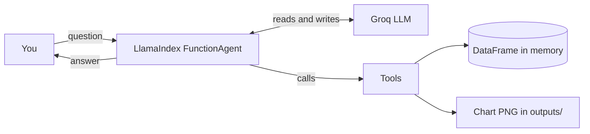

# CSV/Excel Analysis Agent

An AI agent that analyses CSV and Excel files. You ask questions in plain English, and the agent loads the file, cleans it, runs the calculations and draws charts for you.

Built with [LlamaIndex](https://www.llamaindex.ai/) and a free [Groq](https://console.groq.com) LLM.

## What it can do

- Load a CSV, TSV or Excel file and describe it (columns, types, missing values, duplicates)
- Answer questions with real pandas calculations, so the numbers come from code and not from the model's guess
- Clean the data: remove duplicates, fill missing values, trim spaces, fix data types
- Draw bar, line, histogram and scatter charts and save them as PNG files
- Remember the conversation, so you can ask follow-up questions

## How it was built

This project follows five steps.

| Step | Choice |
|---|---|
| 1. Use case | Analyse CSV/Excel files with natural language |
| 2. LLM and provider | `llama-3.3-70b-versatile` on Groq (free tier, supports function calling) |
| 3. Tools | `load_file`, `describe_data`, `clean_data`, `run_pandas`, `plot` |
| 4. System prompt | `csv_agent/prompts.py` |
| 5. Framework | LlamaIndex `FunctionAgent` |



The agent works in a loop. It reads your question, picks a tool, reads the tool result, and repeats until it can answer.

## Tools

| Tool | What it does |
|---|---|
| `load_file(path, sheet)` | Loads a CSV, TSV or `.xlsx` file. For Excel, loads one sheet (the first one unless you name another) |
| `describe_data()` | Shape, column types, missing values, unique counts, duplicate rows, numeric summary |
| `clean_data(action, column, value)` | One cleaning step: `drop_duplicates`, `drop_null_rows`, `fill_null_mean`, `fill_null_median`, `fill_null_mode`, `fill_null_value`, `strip_whitespace`, `to_numeric`, `to_datetime` |
| `run_pandas(code)` | Runs pandas code the agent writes, on a copy of the data, and returns the result |
| `plot(kind, x, y, agg, freq, title)` | Saves a `bar`, `line`, `hist` or `scatter` chart to `outputs/` |

## Quick start

You need Python 3.10 or newer.

```bash
git clone https://github.com/YOUR_USERNAME/csv-excel-analysis-agent.git
cd csv-excel-analysis-agent

python -m venv .venv
source .venv/bin/activate        # Windows: .venv\Scripts\activate
pip install -r requirements.txt
```

Get a free API key at [console.groq.com](https://console.groq.com), then create your `.env` file:

```bash
cp .env.example .env             # Windows: copy .env.example .env
# open .env and paste your key after GROQ_API_KEY=
```

Start the chat:

```bash
python main.py --file data/sample_sales.csv
```

You can also use the notebook in `notebooks/demo.ipynb` (Jupyter or Google Colab).

## Example questions

With `data/sample_sales.csv`:

- Give me an overview of this file.
- Which region has the highest total revenue?
- What are the top 3 products by quantity sold?
- Is the average discount different between categories?
- Are there data quality problems? Fix them.
- Plot monthly revenue as a line chart.
- Show a histogram of customer age.

The sample file has missing values, duplicate rows and extra spaces on purpose, so you can try the cleaning tools. To use your own data, put any CSV or Excel file in the `data/` folder.

## Project structure

```
csv-excel-analysis-agent/
├── main.py                  # terminal chat
├── csv_agent/
│   ├── config.py            # Groq LLM setup
│   ├── prompts.py           # system prompt
│   ├── tools.py             # the five tools
│   ├── agent.py             # builds the LlamaIndex agent
│   └── runner.py            # asks a question and prints tool calls
├── data/
│   ├── sample_sales.csv     # sample data with problems to clean
│   └── generate_sample.py   # recreates the sample file
├── notebooks/demo.ipynb     # step-by-step demo
├── tests/test_tools.py      # tests for the tools (no API key needed)
├── outputs/                 # charts are saved here
├── requirements.txt
└── requirements-dev.txt
```

## Tests

The tests cover the tools and need no API key and no internet.

```bash
pip install -r requirements-dev.txt
pytest -q
```

## Safety note

`run_pandas` runs code written by an LLM. The code is checked first, and imports, file access, `eval`/`exec` and private attributes are blocked. It also runs on a copy of your data. This is a safety net, not a real sandbox, so run this agent on your own machine with your own files. Do not put it online for other people to use as it is.

## Limitations

- Excel files load one sheet at a time. Ask the agent to load another sheet by name.
- The data lives in memory, so very large files will be slow.
- `plot` can only draw columns that exist in the loaded data. It cannot chart the result of a custom calculation.
- The free Groq tier has rate limits. If you hit one, wait a minute and ask again.
- Open-source models can sometimes write a bad tool call. The agent usually fixes it on its own. If it does not, rephrase the question.

## License

MIT. See [LICENSE](LICENSE).
